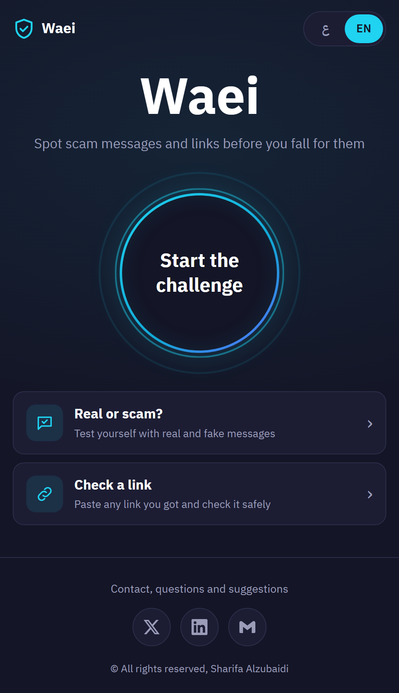
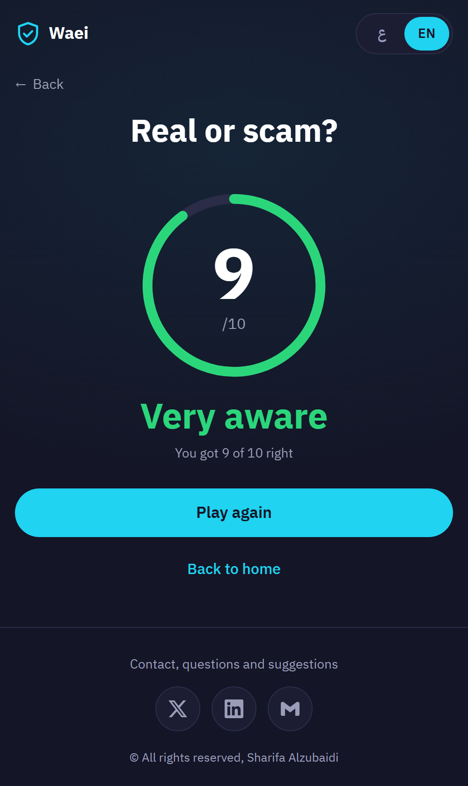
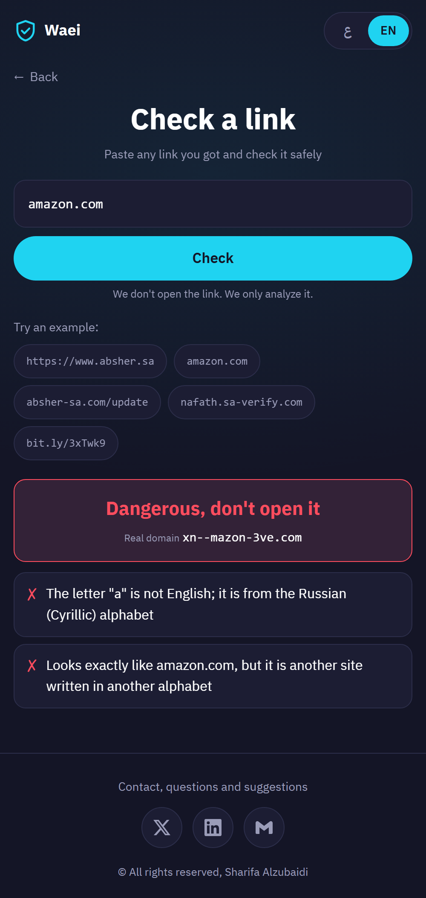
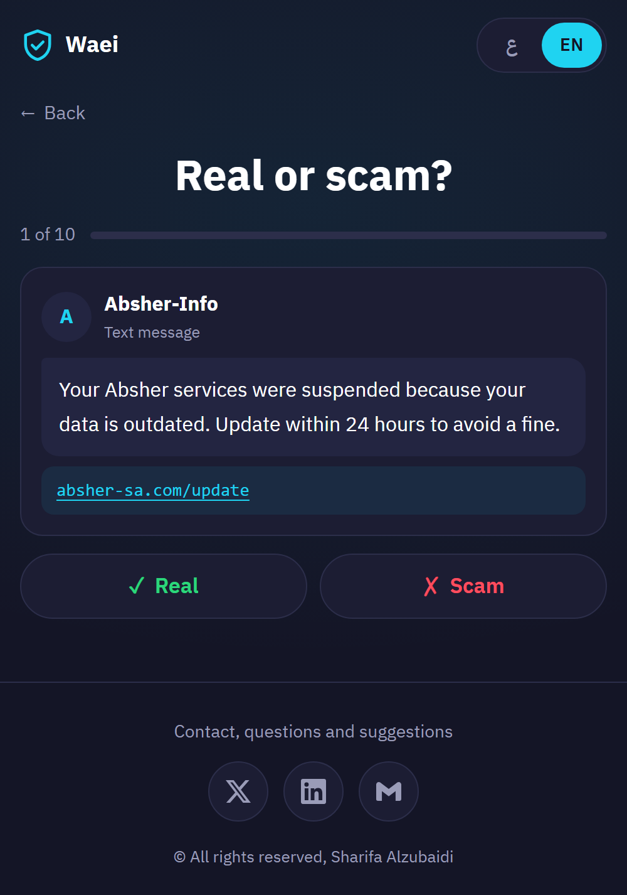
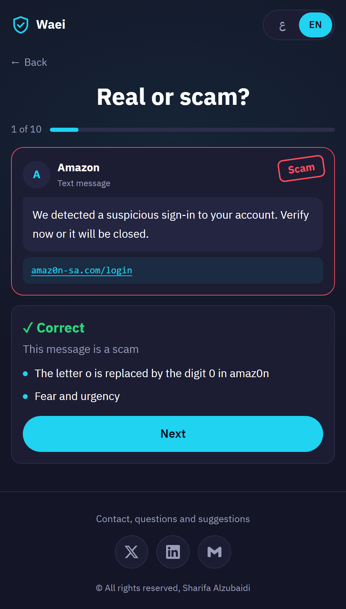
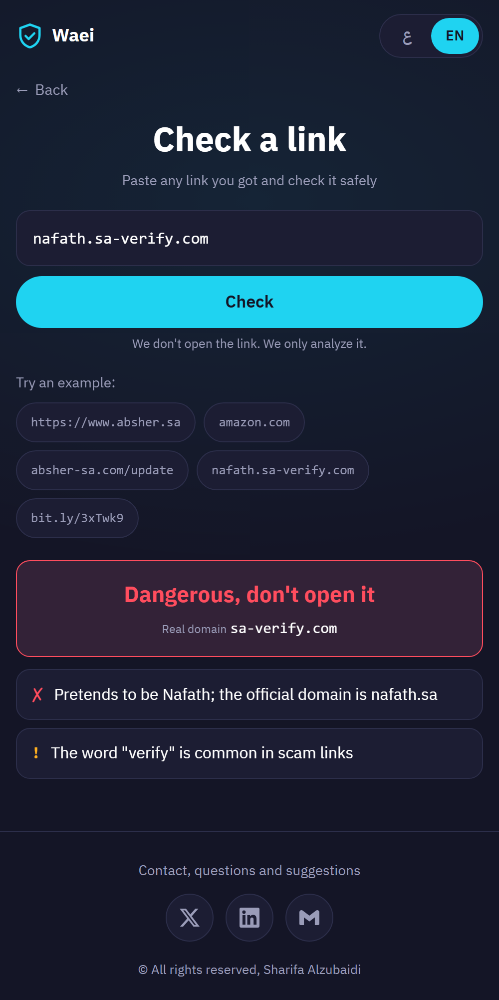
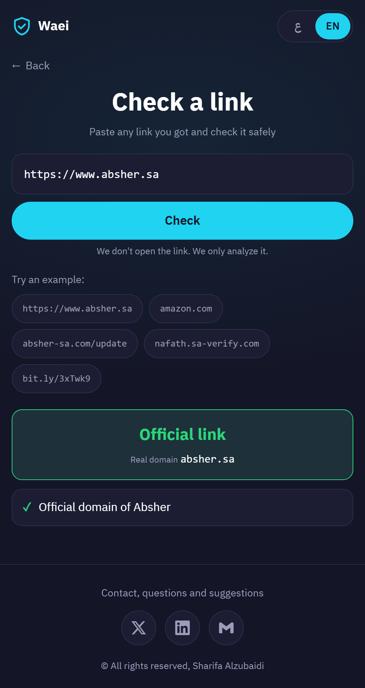
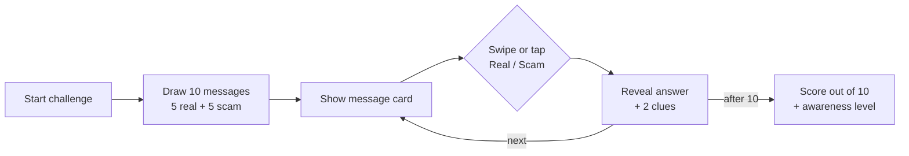
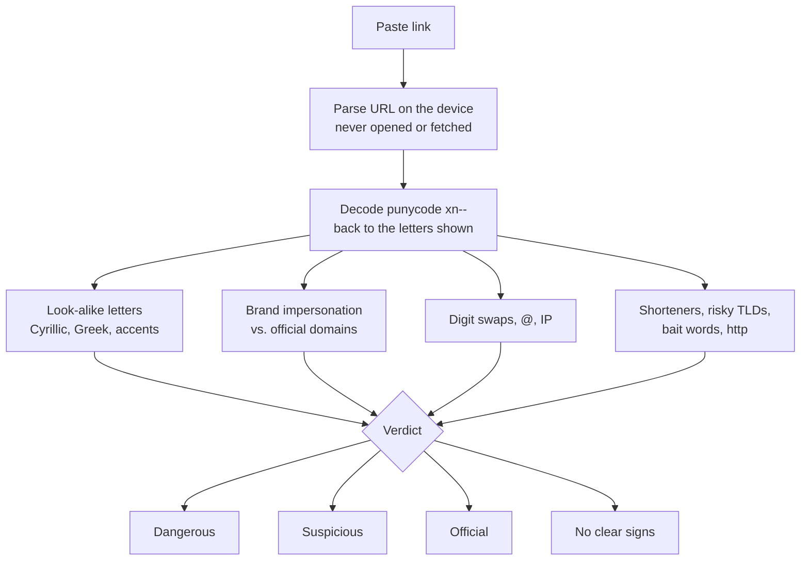

# Waei · واعي

**Spot scam messages and links before you fall for them.**

A free, Arabic-first awareness website built for a cybersecurity awareness campaign. It trains people to recognize the SMS and WhatsApp scams that target users in Saudi Arabia, and gives them a tool to check any suspicious link.

**Live:** https://7sh-mk.github.io/waei/

<p align="center">
  
  
  
</p>

## Features

### 1. Real or Scam?
A short challenge built on messages modeled after real ones from Absher, Nafath, SPL, banks, telecoms and online stores.

- Each round draws 10 messages: 5 real, 5 scams, shuffled. Answering "scam" every time cannot pass.
- Real messages use the official domains (`absher.sa`, `splonline.com.sa`, `stc.com.sa`, `amazon.sa`). Scams use look-alikes (`absher-sa.com`, `nafath.sa-verify.com`, `amaz0n-sa.com`, `bit.ly`), OTP requests, fake prizes, refunds and "new number" family scams.
- Swipe the card or tap **Real** / **Scam**. Every answer reveals the truth and two clues.
- Ends with a score out of 10 and an awareness level.

<p align="center">
  
  
  
</p>

### 2. Link Checker
Paste any link. It is analyzed as text on the device, never opened or fetched, and returns a clear verdict with the real domain behind it.

| Check | Example | Level |
| --- | --- | --- |
| Letters from another alphabet that look English (homograph) | `аmazon.com` with a Cyrillic «а» | Dangerous |
| Brand impersonation on a different domain | `absher-sa.com` instead of `absher.sa` | Dangerous |
| Brand name used as a disguise at the start | `nafath.sa-verify.com` | Dangerous |
| Digits replacing letters | `amaz0n.com` | Dangerous |
| IP address or `@` hiding the destination | `http://192.168.1.5` | Dangerous |
| URL shortener | `bit.ly/...` | Suspicious |
| Unencrypted link, risky TLD, bait words, too many subdomains | `http://`, `.top`, `login`, `gift` | Suspicious |
| Official domain of a known organization | `https://www.absher.sa` | Official |

For homographs, the tool decodes the hidden `xn--` form, names each foreign letter and its alphabet, and states which official site it imitates.

<p align="center">
  
  
  
</p>

## How It Works

**Real or Scam?**



**Link Checker**



## Privacy by Design
- Everything runs in the browser. No server, no accounts, no storage, no analytics, no cookies.
- A Content Security Policy blocks the page from connecting to any external server.
- Links inside both tools are plain text and are never opened.

## Tech Stack
HTML, CSS and vanilla JavaScript. No frameworks, libraries or build step.

## Project Structure
| File | Purpose |
| --- | --- |
| `index.html` | Page markup |
| `style.css` | Styles |
| `app.js` | Routing and language switch |
| `game.js` | Real or Scam? logic |
| `scenarios.js` | Challenge messages (Arabic + English) |
| `link.js` | Link analysis and punycode decoding |
| `config.js` | Official domains, detection rules and all UI text |

## Run Locally
```bash
python -m http.server 8000
```
Then open `http://localhost:8000`.

## Author
**Sharifa Alzubaidi** · [X](https://x.com/7sh_mk) · [LinkedIn](https://www.linkedin.com/in/sharifa-alzubaidi-ksa/)
